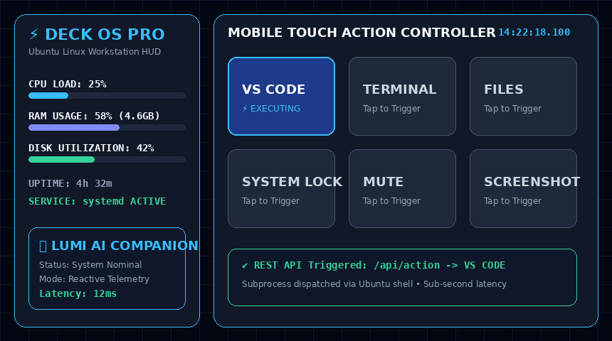

# ⚡ Deck OS Pro

> **A Cyber-Glass Linux command center that transforms an old Android device into a low-latency touchscreen control deck.**

<p align="center">
  <a href="assets/shubham-deck-demo.gif">
    
  </a>
  <br>
  <em>Live Demo: Mobile touchscreen control panel streaming hardware metrics and executing Linux shell workflows</em>
</p>

<p align="center">
  
  
  
  
</p>

## 🚀 Overview

**Deck OS Pro** is a custom Linux-based touchscreen control interface built to repurpose an old Android phone as a **remote workstation command center**.

It combines a **Cyber-Glass HUD**, real-time system telemetry, IP-camera streaming, Linux automation, and persistent background services into a unified control surface.

### Core Stack

* 🪟 **Cyber-Glass UI** — glassmorphism, HUD overlays, dynamic system indicators
* 📡 **V5 Vision Pipeline** — Android IP camera → OpenCV → threaded Flask stream
* 📊 **Real-Time Telemetry** — CPU, RAM, storage and uptime via `psutil`
* ⚙️ **Macro Automation** — app launching, volume control, lock, reboot and shutdown
* 🤖 **Lumi** — interactive visual interface companion
* 🧵 **Concurrent Backend** — threaded Flask architecture for non-blocking operations
* 🚀 **Persistent Runtime** — `systemd --user` background service

## 🧠 Architecture

```text
Android Device
     │
     ├── Touchscreen
     └── IP Camera
            │
            ▼
     ┌───────────────┐
     │   Flask API   │
     └───────┬───────┘
             │
      ┌──────┼──────────┐
      ▼      ▼          ▼
   Telemetry Vision   Automation
    psutil  OpenCV    Linux Commands
      │      │          │
      └──────┴──────────┘
             ▼
       Cyber-Glass UI
```

## 🔥 Key Capabilities

| System               | Function                              |
| -------------------- | ------------------------------------- |
| **Control Deck**     | Touch-based workstation control       |
| **Telemetry Engine** | Live hardware/system monitoring       |
| **Vision Pipeline**  | Low-latency network video + HUD       |
| **Macro Engine**     | One-tap Linux automation              |
| **System Layer**     | Lock, reboot, shutdown, audio control |
| **Service Layer**    | Persistent `systemd` execution        |

## 🛠️ Technology

**Frontend:** HTML5 · CSS3 · JavaScript · Glassmorphism UI
**Backend:** Python · Flask · Threading
**Vision:** OpenCV · IP/MJPEG Streaming
**System:** `psutil` · PulseAudio · Linux · systemd
**Infrastructure:** Git · GitHub · Local Network

## 🎯 Design Philosophy

**Repurpose → Integrate → Automate**

Instead of letting an old smartphone become e-waste, Deck OS Pro turns its **touchscreen, camera and network stack** into a software-defined workstation control surface.

## 📈 Future Expansion

GPU telemetry · OBS controls · Media controls · Network monitoring · WebSockets · Custom macros · Plugin architecture · Multi-device control

---

<p align="center">

**DECK OS PRO**
`Cyber-Glass • Computer Vision • Linux Automation • Remote Control`

</p>
